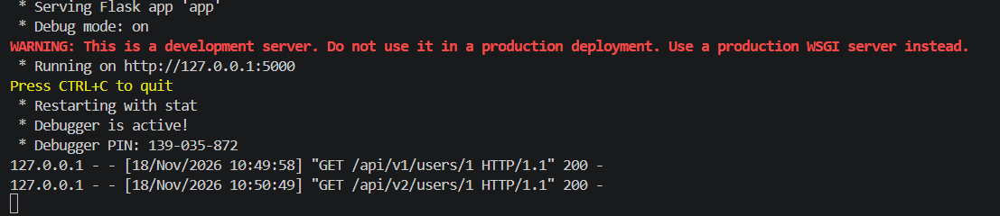
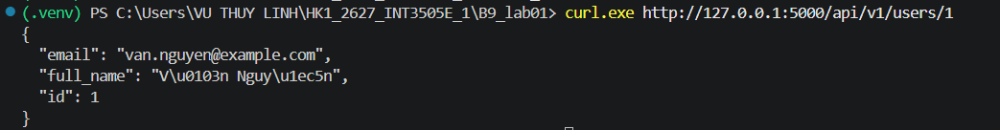
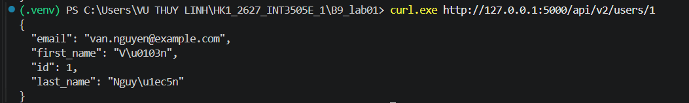

# B9 - Lab 01: URI Path Versioning với Flask Blueprint
## Cấu trúc thư mục
```text
B9_lab01/
├── app.py                  # Khởi tạo ứng dụng Flask và đăng ký Blueprint v1, v2
├── blueprints/
│   ├── users_data.py       # Dữ liệu người dùng mẫu và hàm truy xuất get_user()
│   ├── v1.py               # Định nghĩa endpoint cho API v1 (trả về full_name)
│   └── v2.py               # Định nghĩa endpoint cho API v2 (tách first_name, last_name)
├── img/
│   ├── on.png
│   ├── v1.png
│   └── v2.png
└── README.md
```

## Đặc tả các phiên bản API
| Phiên bản | Phương thức & Endpoint | Dữ liệu trả về (`200 OK`) | Trường hợp lỗi (`404 Not Found`) |
| :--- | :--- | :--- | :--- |
| **v1** | `GET /api/v1/users/<int:uid>` | `{"id": 1, "full_name": "...", "email": "..."}` | `{"error": "nf"}` |
| **v2** | `GET /api/v2/users/<int:uid>` | `{"id": 1, "first_name": "...", "last_name": "...", "email": "..."}` | `{"error": "nf"}` |

## Hướng dẫn cài đặt và khởi chạy
1. Mở Terminal trong VS Code và di chuyển vào thư mục bài thực hành:
   ```powershell
   cd B9_lab01
   ```
2. Cài đặt thư viện Flask (bỏ qua nếu đã cài trong môi trường ảo `.venv`):
   ```powershell
   pip install flask
   ```
3. Khởi chạy server:
   ```powershell
   python app.py
   ```
   Server sẽ chạy ở chế độ debug tại địa chỉ `http://127.0.0.1:5000`.

## Kết quả kiểm thử
### 1. Flask Server
Server tiếp nhận và xử lý thành công cả hai yêu cầu `GET` tới `v1` và `v2` với mã trạng thái `200 OK`:



### 2. Kiểm thử API v1 (`GET /api/v1/users/1`)
Lệnh thực thi trên PowerShell:
```powershell
curl.exe http://127.0.0.1:5000/api/v1/users/1
```


### 3. Kiểm thử API v2 (`GET /api/v2/users/1`)
Lệnh thực thi trên PowerShell:
```powershell
curl.exe http://127.0.0.1:5000/api/v2/users/1
```
