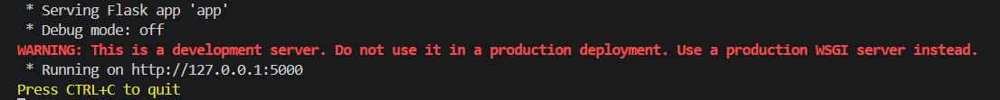
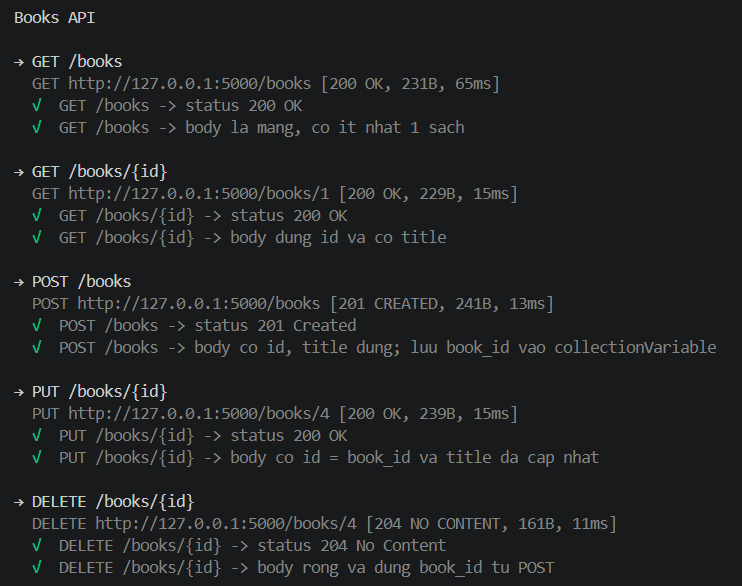
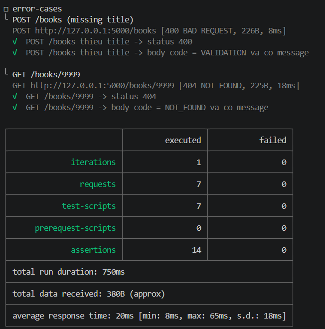

# Lab 3 — Build Newman-runnable collection
Collection `books-api.postman_collection.json` kiểm thử Books API (Flask) và **chạy độc lập bằng Newman**, không cần mở Postman UI. 
## Cấu trúc thư mục
```
lab03/
├── app.py                              # Flask Books API (in-memory), cổng 5000
├── requirements.txt                    # Dependency Python (Flask)
├── books-api.postman_collection.json   # Collection: 5 happy-path + folder error-cases (2 request)
├── staging.postman_environment.json    # Environment, chứa baseUrl
├── run_tests.sh                        # Script chạy tự động (bash / Git Bash / WSL / macOS / Linux)
├── junit.xml                           # Kết quả JUnit, sinh ra sau khi chạy Newman
├── README.md
└── recs/                               # Ảnh chụp kết quả chạy thực tế
```
## Yêu cầu môi trường
- Python 3.9 trở lên
- Node.js 18 trở lên (có `npm`)

## Cách chạy

### Cách 1 — Windows PowerShell / terminal VS Code 

```powershell
pip install -r requirements.txt
npm install -g newman
```
**Terminal 1 — bật API và để nó chạy:**
```powershell
python app.py
```

Thấy `Running on http://127.0.0.1:5000` là API đã sẵn sàng.

**Terminal 2 (bấm dấu `+` trong VS Code để mở terminal mới) — chạy Newman:**

```powershell
newman run books-api.postman_collection.json -e staging.postman_environment.json -r "cli,junit" --reporter-junit-export junit.xml
```

### Cách 2 — macOS / Linux / Git Bash / WSL 

```bash
chmod +x run_tests.sh
./run_tests.sh
```
Script tự cài thư viện còn thiếu, bật Flask nền, chờ API sẵn sàng, chạy Newman với `-r cli,junit`, xuất `junit.xml` rồi tắt Flask.
## Kết quả chạy 
### Flask API đang chạy



### Newman: 5 happy-path



### `error-cases` và bảng tổng kết




