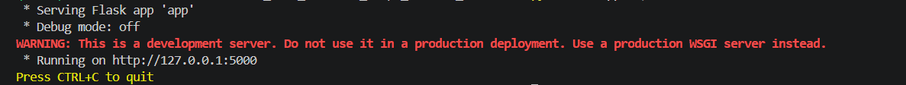
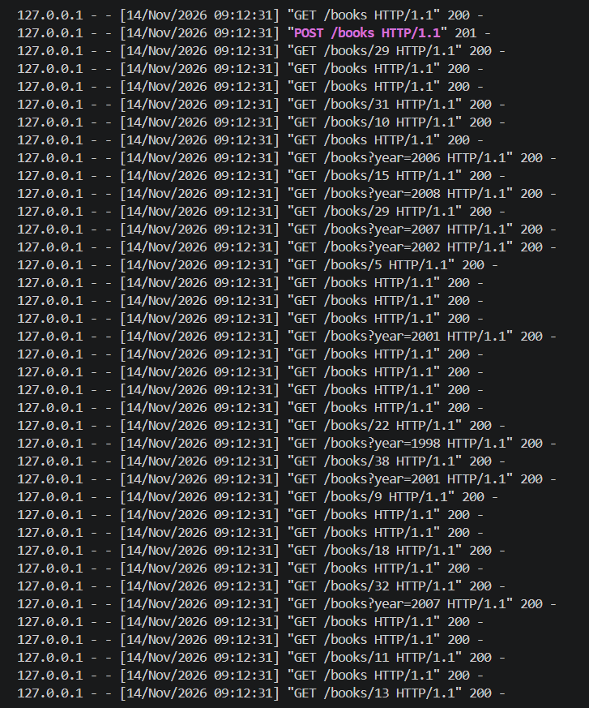
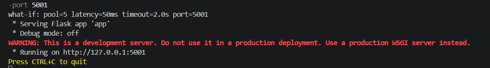
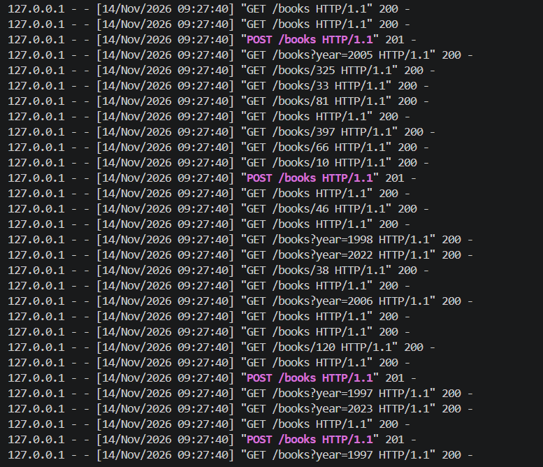

# Lab 04 - Load test Books API với Locust
Load test Books API (Flask, dữ liệu in-memory từ Lab 3) bằng Locust ở 3 mức tải: nhẹ, thông thường và spike.

## Cấu trúc
| File | Mô tả |
|---|---|
| `app.py` | Books API của Lab 3 (cổng 5000) |
| `locustfile.py` | Kịch bản Locust: `GET /books`, `GET /books/[id]`, `search_by_year(year)` (1% lỗi giả lập 500), `POST /books` |
| `run_scenarios.py` | (Tuỳ chọn) Tự động chạy cả 3 kịch bản |
| `reports/A.html`, `B.html`, `C.html` | Báo cáo Locust của 3 kịch bản |
| `analysis.md` | Phân tích kết quả (3 câu hỏi + bonus) |
| `screenshots/` | Ảnh chụp terminal khi chạy API và chạy tải (minh chứng đã chạy) |

## Cách chạy
```bash
pip install flask locust
```
Terminal 1 chạy API, terminal 2 chạy từng kịch bản (restart API giữa các lần chạy):

```bash
python -m app --port 5000
```
```bash
locust -f locustfile.py --headless -u 10  -r 2  -t 30s --html reports/A.html
locust -f locustfile.py --headless -u 50  -r 5  -t 60s --html reports/B.html
locust -f locustfile.py --headless -u 200 -r 50 -t 30s --html reports/C.html
```

## Kịch bản
| | Mục đích | User | Spawn rate | Thời gian |
|---|---|---|---|---|
| A | Baseline (nhẹ) | 10 | 2/s | 30s |
| B | Load test thông thường | 50 | 5/s | 60s |
| C | Spike test | 200 | 50/s | 30s |

## Kết quả
| Kịch bản | Requests | RPS | p95 (ms) | p99 (ms) | Fail |
|---|---|---|---|---|---|
| A | 277 | 9.6 | 38 | 150 | 0 (0%) |
| B | 2718 | 46.0 | 23 | 65 | 7 (0.26%) |
| C | 5484 | 185.2 | 87 | 130 | 8 (0.15%) |

Cả 3 kịch bản đều đạt SLO p95 < 300 ms; C có p95 cao nhất (87 ms). p95 của A cao hơn B vì A chỉ có 277 request nên p95 rất nhạy với vài request chậm. Toàn bộ lỗi là 1% lỗi giả lập của `search_by_year`, server không trả mã lỗi nào.

## Bonus: connection pool = 5
`pool_whatif.py` bọc `app.py` bằng một pool giả lập (5 connection, độ trễ DB 50 ms, chờ quá 2 s thì trả 503), chạy ở cổng 5001:

```bash
python pool_whatif.py --port 5001
locust -f locustfile.py --headless --host http://127.0.0.1:5001 -u 200 -r 50 -t 30s --html bonus/pool5.html
```
Chạy lại với `POOL_SIZE=20` để so sánh. Kết quả (200 user, `-r 50 -t 30s`):
| Cấu hình | RPS | p50 | p95 | p99 | Fail |
|---|---|---|---|---|---|
| pool = 5 | 92.4 | 1100 ms | 1900 ms | 2100 ms | 42 / 2779 (1.51%): 32 lỗi 503 + 10 lỗi giả lập |
| pool = 20 | 167.0 | 82 ms | 240 ms | 430 ms | 12 / 4892 (0.25%): toàn bộ là lỗi giả lập |

Thông lượng tối đa của pool ≈ `số connection / thời gian giữ connection` = 5 / 0.05 s ≈ 100 RPS, khớp với 92 RPS đo được. Với 200 user, tải vượt mức này nên request phải xếp hàng chờ connection: latency tăng vọt, RPS đi ngang và xuất hiện lỗi 503 khi chờ quá timeout.

## Minh chứng chạy
### Flask API đang chạy


### Log API khi load test


### Server pool_whatif khởi động


### Log server pool_whatif khi load test



