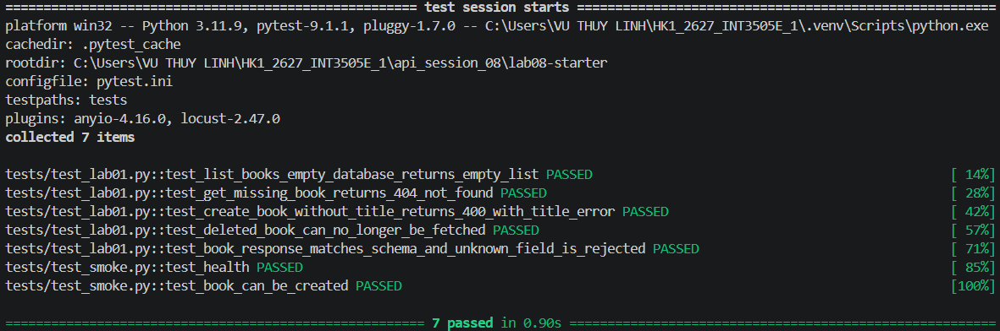
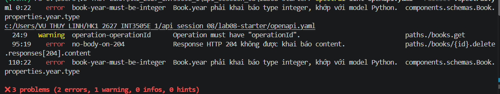
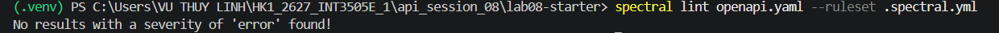

# Lab 08 - API Testing (Lab 01 + Lab 02)
Books API (Flask): kiểm thử bằng pytest và lint OpenAPI bằng Spectral.
## Cài đặt
```bash
git clone https://github.com/TrinhLK/lab08-starter.git
cd lab08-starter
python -m venv .venv
.venv\Scripts\activate           # Windows
pip install -r requirements.txt  # flask, pytest, jsonschema
npm install -g @stoplight/spectral-cli
```
## Lab 01 - Test Books API
Chạy: `pytest -v` 
| Test | Kiểm tra |
|---|---|
| `test_list_books_empty_database_returns_empty_list` | `GET /books` khi CSDL rỗng trả về `[]` (không phải `null`) |
| `test_get_missing_book_returns_404_not_found` | `GET /books/<id>` không tồn tại → 404, `code: NOT_FOUND` |
| `test_create_book_without_title_returns_400_with_title_error` | `POST /books` thiếu `title` → 400, `errors` có field `title` |
| `test_deleted_book_can_no_longer_be_fetched` | Xoá rồi `GET` cùng id → 404 |
| `test_book_response_matches_schema_and_unknown_field_is_rejected` | (Bonus) Response khớp schema `jsonschema`, không lộ field lạ như `password_hash` |
| `test_health`, `test_book_can_be_created` | Smoke test |

Kết quả chạy:


## Lab 02 - Lint OpenAPI bằng Spectral
Chạy: `spectral lint openapi.yaml --ruleset .spectral.yml`
3 lỗi cố ý trong `openapi.yaml` và cách sửa:

| Rule | Vị trí | Cách sửa |
|---|---|---|
| `operation-operationId` (warning) | `GET /books` | Thêm `operationId: listBooks` |
| `no-body-on-204` (error) | `DELETE /books/{id}` → 204 | Bỏ `content` khỏi response 204 |
| `book-year-must-be-integer` (error) | `Book.year` | Đổi `type: string` → `type: integer` (khớp model Python) |

**Custom rule** `response-200-schema-has-fields` (`.spectral.yml`): response 200 phải có schema với ít nhất 1 trường (`properties`, hoặc `items.properties` nếu là mảng). Rule bắt trường hợp spec vẫn hợp lệ nhưng schema rỗng (ví dụ `schema: {type: object}`), khi đó client không biết response có field nào.

Kết quả - trước khi sửa:


Sau khi sửa (không còn lỗi):


## Cấu trúc
```
tests/       # test_lab01.py, test_smoke.py
img/        # ảnh kết quả
pytest.ini
openapi.yaml
.spectral.yml
```
