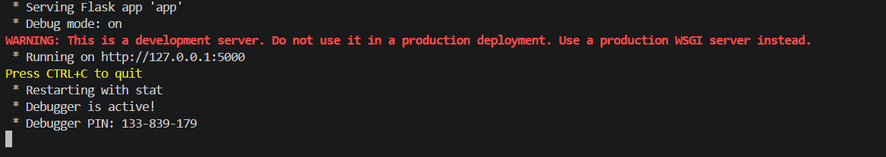
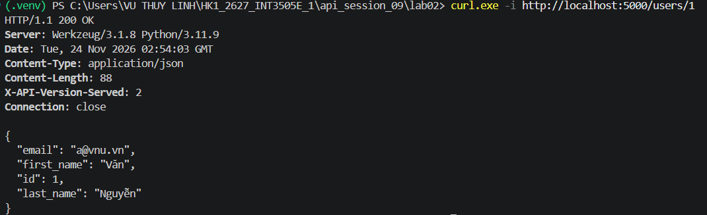
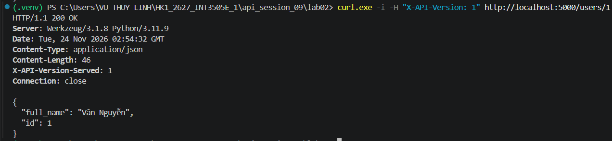
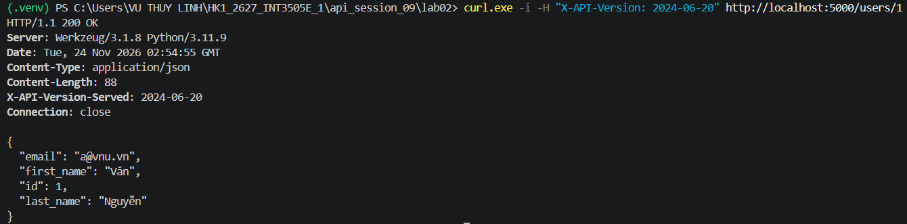
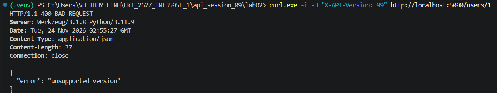

# Lab 02: API Header Versioning với Decorator `@api_version`
## 1. Mục tiêu
Triển khai cơ chế quản lý phiên bản API thông qua HTTP Header trên cùng một endpoint duy nhất `GET /users/<int:uid>`:
* Hỗ trợ 3 phiên bản: `"1"`, `"2"` (mặc định), và `"2024-06-20"`.
* Client chọn phiên bản qua header `X-API-Version`.
* Server trả về header `X-API-Version-Served` để xác nhận phiên bản đã phục vụ.
* Trả về lỗi `400 Bad Request` nếu client gửi phiên bản không nằm trong danh sách hỗ trợ (không tự động fallback).
---

## 2. Cách chạy server
```powershell
flask --app app run --debug
```
Server chạy tại địa chỉ: `http://127.0.0.1:5000`
---

## 3. Kết quả kiểm thử 
### Flask API đang chạy ở cổng 5000


### Case 1: Mặc định 


### Case 2: Chỉ định rõ phiên bản v1


### Case 3: Phiên bản theo ngày (2024-06-20)


### Case 4: Phiên bản không hỗ trợ 
