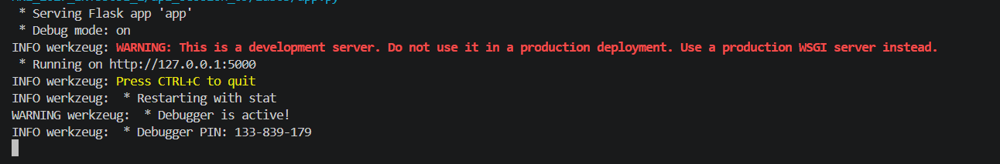
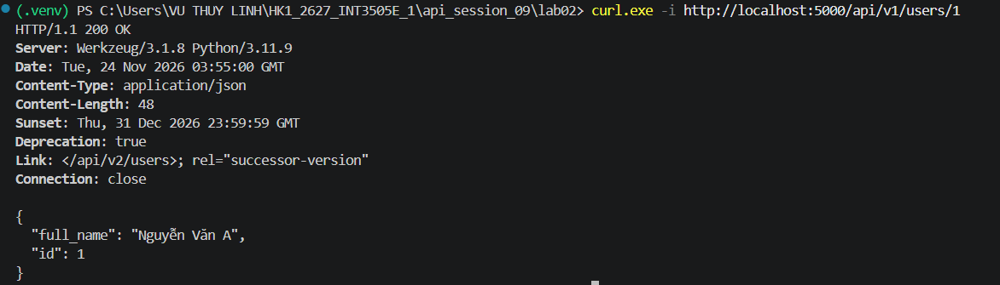
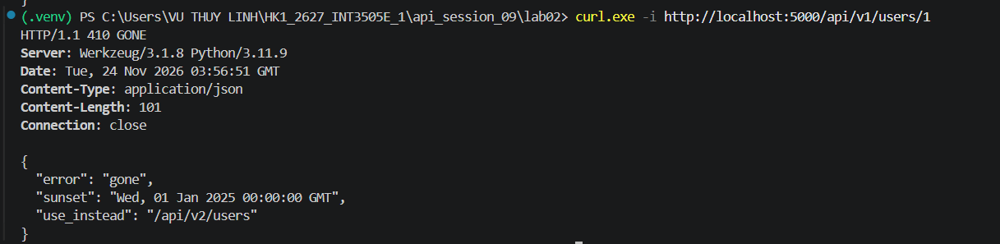
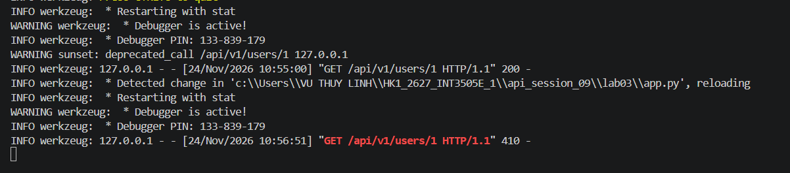

# Lab 03: Sunset Middleware với Decorator `@deprecate_at`
## 1. Mục tiêu
Triển khai decorator tái sử dụng `@deprecate_at(sunset_date, replacement)` theo chuẩn **RFC 8594** để quản lý vòng đời ngừng hỗ trợ (deprecation) của API:
- Trước thời điểm Sunset: Trả về dữ liệu bình thường kèm các header `Sunset`, `Deprecation: true` và `Link` trỏ tới phiên bản thay thế
- Sau thời điểm Sunset: Chặn truy cập và trả về mã lỗi `410 Gone` kèm thông tin đường dẫn thay thế (`use_instead`)
- Logging: Ghi nhận cảnh báo (`WARNING`) trên server mỗi khi endpoint cũ được gọi

## 2. Cấu trúc & Cách chạy
- `sunset.py`: Định nghĩa decorator `@deprecate_at` và hàm định dạng thời gian chuẩn HTTP (`http_date`).
- `app.py`: Khai báo mốc `V1_SUNSET` và áp dụng decorator lên route `GET /api/v1/users/<int:uid>`.

Khởi động server trong thư mục `lab03`:
```powershell
cd lab03
python app.py
```
## Minh chứng chạy
### Flask API đang chạy ở cổng 5000


### 1: Trước thời điểm Sunset (HTTP 200 OK + Sunset Headers)


### 2: Sau thời điểm Sunset (HTTP 410 Gone)


### 3: Log cảnh báo `deprecated_call` trên server
