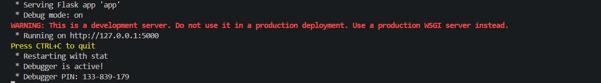
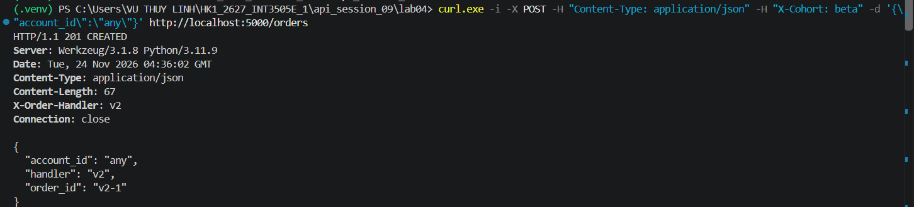
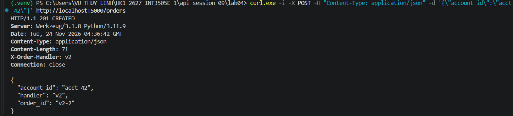
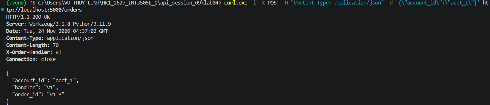
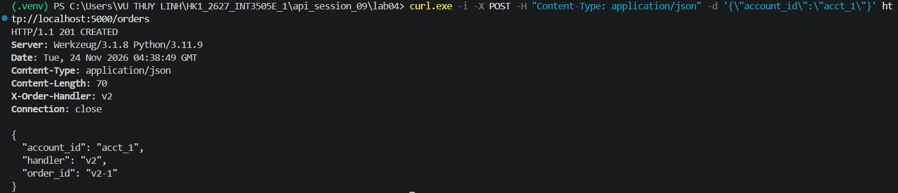

# Lab 04: Blue-Green Routing với Gateway Pattern
## 1. Mục tiêu
Triển khai cơ chế điều hướng lưu lượng (Blue-Green Routing) trên cùng một endpoint duy nhất `POST /orders` tới `v1` (Blue) hoặc `v2` (Green) theo 3 tầng ưu tiên:
- Header Cohort (`X-Cohort`): Các nhóm `beta`, `internal` được ưu tiên cao nhất và luôn định tuyến sang `v2`.
- Account Allow-list: Các tài khoản chỉ định (`acct_42`, `acct_99`) luôn sử dụng `v2`.
- Hash Bucket theo tỷ lệ `%` (`V2_PERCENT`): Chia lưu lượng nhất quán dựa trên giá trị băm MD5 của `account_id`, cho phép tăng dần tỷ lệ từ `5%` lên `100%` trước khi ngừng hỗ trợ `v1`.
Response trả về kèm header `X-Order-Handler` (`v1` hoặc `v2`) cùng mã trạng thái tương ứng (`200 OK` cho `v1`, `201 Created` cho `v2`).

## 2. Cấu trúc & Cách chạy
* `handlers.py`: Định nghĩa hai hàm xử lý đơn hàng `v1_create_order` và `v2_create_order`.
* `gateway.py`: Cài đặt logic điều hướng 3 tầng (`route_to_v2`, `dispatch`).
* `app.py`: Khai báo endpoint `POST /orders` và gắn header `X-Order-Handler`.

Khởi động server trong thư mục `lab04`:
```powershell
cd lab04
python app.py
```
## Kết quả chạy
### Flask API đang chạy ở cổng 5000


### Case 1: Header `X-Cohort: beta` 


### Case 2: Tài khoản trong allow-list `acct_42` 


### Case 3: Tài khoản thường `acct_1` khi `V2_PERCENT = 5` 


### Case 4: Tăng rollout `V2_PERCENT = 100` cho `acct_1` 
